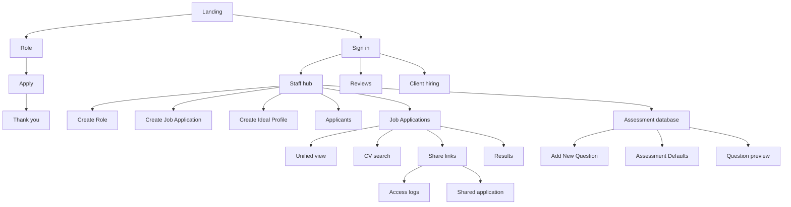
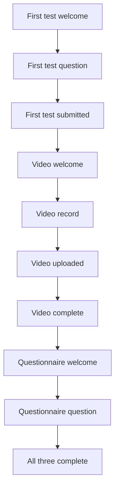

# Mockups

Pictures of each screen. Who sees it, which path it is, and how you open it. Calls stay in the API [service.md](https://github.com/WhiteboardNewbie/TR-x-Amal-Careers-API/blob/main/docs/service.md).

The files sit in this folder, grouped by who opens the screen.

Sign in also lands an assigned employee on Reviews and a client user on Hiring. The candidate invite is the email link, not the staff navbar.

## Visitor

| Screen | Path | Opened from | File |
| --- | --- | --- | --- |
| Role list | `/` | Public board | `visitor/landing.jpg` |
| No roles in a department | `/` | Department filter with no matches | `visitor/landing-empty.jpg` |
| Role | `/roles/[slug]` | A card on the list | `visitor/role.jpg` |
| Role closed | `/roles/[slug]` | A draft, inactive, or unknown slug | `visitor/role-closed.jpg` |
| Apply | `/roles/[slug]/apply` | Apply on the role page | `visitor/apply.jpg` |
| Thank you | `/roles/[slug]/applied` | A successful apply | `visitor/thank-you.jpg` |
| Confirmation email | — | Sent by the apply call | `visitor/email-application-received.jpg` |
| Assessment invite | — | Send Test on a Job Applications row | `visitor/email-assessment-invite.jpg` |
| Application rejected | — | Status changes to rejected | `visitor/email-application-rejected.jpg` |
| Application on hold | — | Status changes to parking-lot | `visitor/email-application-parking-lot.jpg` |

## Sign in

| Screen | Path | Opened from | File |
| --- | --- | --- | --- |
| Sign in | `/sign-in` | Sign in on `/` | `visitor/sign-in.jpg` |

Hiring staff land on `/staff`, an assigned employee on `/reviews`, a client user on `/client`.

## Hiring staff

Banner Create Role, Create Job Application, and Create Ideal Profile each open a modal over `/staff`.

| Screen | Path | Opened from | File |
| --- | --- | --- | --- |
| Roles | `/staff` | Sign in as hiring staff. Roles tab. | `staff/staff-roles.jpg` |
| Create Role | `/staff` | Banner Create Role | `staff/staff-role-form.jpg` |
| Create Job Application | `/staff` | Banner Create Job Application | `staff/staff-create-application.jpg` |
| Create Ideal Profile Template | `/staff` | Banner Create Ideal Profile | `staff/staff-ideal-profile.jpg` |
| Applicants | `/staff` | Applicants tab | `staff/staff-applicants.jpg` |
| Applicant profile | `/staff` | A row on Applicants | `staff/staff-applicant.jpg` |
| Job Applications | `/staff` | Job Applications tab | `staff/staff-applications.jpg` |
| Application detail | `/staff` | A row on Job Applications | `staff/staff-application.jpg` |
| Stage Assignments | `/staff` | Stage Assignments tab | `staff/staff-stage-assignments.jpg` |
| Manage Applications | `/staff` | Manage Applications tab | `staff/staff-manage-applications.jpg` |

### From Job Applications

CV search and Shared links are not navbar items.

| Screen | Path | Opened from | File |
| --- | --- | --- | --- |
| Unified view | `/staff/applications/[id]` | Eye on a Job Applications row | `staff/staff-unified.jpg` |
| Advanced CV search | `/staff/cv-search` | Advanced Search | `staff/staff-cv-search.jpg` |
| Shared links | `/staff/share-links` | Shared links | `staff/staff-share-links.jpg` |
| Access logs | `/staff/share-links/[id]/logs` | Page-with-lines action on a share-link row | `staff/staff-share-link-logs.jpg` |
| First-test result | `/staff/applications/[id]/results/first-test` | A completed first-test cell | `staff/staff-result-first-test.jpg` |
| Video result | `/staff/applications/[id]/results/video` | A completed video-test cell | `staff/staff-result-video.jpg` |
| Questionnaire result | `/staff/applications/[id]/results/questionnaire` | A completed questionnaire cell | `staff/staff-result-questionnaire.jpg` |

### Assessment database

Navbar Assessment database. Not under Careers tabs.

| Screen | Path | Opened from | File |
| --- | --- | --- | --- |
| Assessment Database | `/staff/questions` | Assessment database in the navbar | `staff/staff-questions.jpg` |
| Add New Question | `/staff/questions` | + Add Question | `staff/staff-add-question.jpg` |
| Assessment Defaults | `/staff/questions` | Banner Assessment Defaults | `staff/staff-assessment-defaults.jpg` |
| Candidate first-test preview | `/staff/questions` | Eye on an MCQ row | `staff/staff-question-preview.jpg` |

### Organizational Configuration

Navbar Organizational Configuration. The records Careers reads: the role department, the ideal-profile title, the stage picker, and client review. Same tables as the ERP Organization Overview Departments, Levels, and Titles tabs, plus Clients. No org chart and no statistics.

| Screen | Path | Opened from | File |
| --- | --- | --- | --- |
| Departments | `/staff/organization` | Organizational Configuration in the navbar | `staff/staff-org-departments.jpg` |
| Levels | `/staff/organization` | Levels tab | `staff/staff-org-levels.jpg` |
| Titles | `/staff/organization` | Titles tab | `staff/staff-org-titles.jpg` |
| Clients | `/staff/organization` | Clients tab | `staff/staff-org-clients.jpg` |

## Assigned employee

| Screen | Path | Opened from | File |
| --- | --- | --- | --- |
| Reviews | `/reviews` | Sign in as an assigned employee | `reviews/reviews.jpg` |
| One application | `/reviews/[id]` | A row on Reviews | `reviews/review.jpg` |

## Client user

| Screen | Path | Opened from | File |
| --- | --- | --- | --- |
| Hiring | `/client` | Sign in as a client user | `client/client.jpg` |
| Role | `/client/roles/[slug]` | A role on Hiring | `client/client-role.jpg` |
| Application | `/client/applications/[id]` | A row on that role | `client/client-application.jpg` |

## Candidate

No navbar. The invite email opens the card.

| Screen | Path | Opened from | File |
| --- | --- | --- | --- |
| First-test welcome | `/assessment/[token]` | Invite link | `candidate/assessment.jpg` |
| First-test question | `/assessment/[token]` | Start Test | `candidate/assessment-question.jpg` |
| Submit Test | `/assessment/[token]` | Submit on the last first-test question | `candidate/assessment-submit.jpg` |
| First test submitted | `/assessment/[token]` | After first-test complete | `candidate/assessment-first-done.jpg` |
| Video welcome | `/assessment/[token]` | Continue To Video Test | `candidate/assessment-video.jpg` |
| Video record | `/assessment/[token]` | Start Video Test | `candidate/assessment-video-record.jpg` |
| Video uploaded | `/assessment/[token]` | After a prompt uploads | `candidate/assessment-video-uploaded.jpg` |
| Video complete | `/assessment/[token]` | After the last prompt | `candidate/assessment-video-done.jpg` |
| Questionnaire welcome | `/assessment/[token]` | Continue To Questionnaire | `candidate/assessment-questionnaire.jpg` |
| Questionnaire question | `/assessment/[token]` | Start Questionnaire | `candidate/assessment-questionnaire-question.jpg` |
| Submit Questionnaire | `/assessment/[token]` | Submit Questionnaire | `candidate/assessment-questionnaire-submit.jpg` |
| All three complete | `/assessment/[token]` | After questionnaire complete | `candidate/assessment-complete.jpg` |
| Expired | `/assessment/[token]` | An expired invite | `candidate/assessment-expired.jpg` |

## Share viewer

No navbar.

| Screen | Path | Opened from | File |
| --- | --- | --- | --- |
| Shared application | `/shared/[id]` | A share URL | `shared/shared.jpg` |
